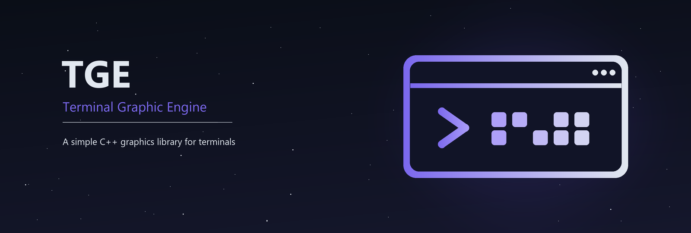

# TGE - Terminal Graphic Engine



[](#getting-started)
[](TGE.hpp)
[](TGE.hpp)
[](LICENSE)
[](https://github.com/Skell4/TGE/stargazers)

TGE is a **header-only C++17 library for drawing graphics in the terminal**.
Create a canvas, draw shapes, text or images, and call `print()` to display it.
Each terminal cell represents two vertical pixels using 24-bit ANSI colors.

The library works on Windows and Linux and has **no third-party dependencies**.
All its code, including the PNG, BMP, ICO and SVG decoders, is in `TGE.hpp`.

## Contents

- [Features](#features)
- [Getting started](#getting-started)
- [Example](#example)
- [Building](#building)
- [Drawing](#drawing)
- [Images and textures](#images-and-textures)
- [Colors](#colors)
- [Canvas and terminal](#canvas-and-terminal)
- [Bitmap text](#bitmap-text)
- [Repository files](#repository-files)
- [Version 4.2 notes](#version-42-notes)
- [License](#license)

## Features

- Pixels, thick lines, rectangles and circles, including filled shapes.
- Bitmap text with uppercase and lowercase letters, digits and symbols.
- Direct PNG, BMP, ICO and static SVG loading with transparency where supported.
- SVG paths, transforms, gradients and antialiased rasterization at a chosen size.
- Image scaling and texture mapping onto a quadrilateral.
- RGBA colors and alpha-based RGB blending when drawing.
- Frame output that skips terminal cells unchanged since the previous frame.

## Getting started

Copy [TGE.hpp](TGE.hpp) into your project and include it:

```cpp
#include "TGE.hpp"
```

Use a compiler with **C++17 or later**. There is no separate library to build
or link, and the header can be included in multiple source files.

Run graphical programs in an interactive terminal with **UTF-8 and 24-bit ANSI
color support**. An IDE output panel may not support the terminal features TGE
uses. The terminal font and cell proportions affect how graphics look.

The public types are in the `tge` namespace:

| Type | Purpose |
| --- | --- |
| `tge::Color` | An RGBA color with 8-bit channels. |
| `tge::Canvas` | A drawing surface stored in memory. |
| `tge::Img` | An alias for `Canvas`, used for images. |
| `tge::Font` | The built-in bitmap font. |

Keyboard and mouse input are handled by your application.

## Example

The included [example.cpp](example.cpp) repeatedly draws two circles and a square.
The canvas follows the terminal size. **Press Ctrl+C to stop the program.**
Use at least 66 columns and 12 rows to see all three shapes; smaller windows
clip them. This minimal example does not restore the terminal when interrupted.

```cpp
#include "TGE.hpp"

int main() {
    tge::Canvas canvas;
    tge::Canvas::initializeTerminal();

    while (true) {
        canvas.resize(tge::Canvas::getScreenSize());
        canvas.setBG(tge::Color::black);

        canvas.drawCircle(12, 12, 8, tge::Color::yellow);
        canvas.drawFilledCircle(34, 12, 8, tge::Color::green);
        canvas.drawFilledRect(50, 4, 16, 16, tge::Color::blue);

        canvas.print();
        tge::Canvas::sleep(16);
    }

}
```

Drawing changes the canvas in memory. `initializeTerminal()` opens the display
session, `print()` shows the canvas, and `resetTerminal()` restores the terminal.
Calling `resize()` with unchanged dimensions keeps the existing storage. The
16 ms pause limits how often the loop runs.

## Building

Keep `example.cpp` and `TGE.hpp` in the same directory.

### Windows - GCC / MinGW

```powershell
g++ -std=c++17 -O2 example.cpp -o example.exe
.\example.exe
```

### Windows - MSVC

In a Visual Studio developer command prompt:

```bat
cl /EHsc /std:c++17 /utf-8 example.cpp /Fe:example.exe
example.exe
```

### Linux - GCC

```sh
g++ -std=c++17 -O2 example.cpp -o example -pthread
./example
```

## Drawing

Coordinates and dimensions are measured in **graphics pixels**. The origin
`(0, 0)` is at the top-left; X increases to the right and Y downward. Drawing
is clipped to the canvas boundaries.

One terminal cell holds two vertical pixels. A canvas of `60 × 24` pixels
therefore occupies 60 columns and 12 terminal rows.

| Call | What it draws |
| --- | --- |
| `drawPixel(x, y, color)` | One pixel. |
| `drawLine(x0, y0, x1, y1, thickness, color)` | A line with the given thickness. |
| `drawRect(x, y, width, height, thickness, color)` | A rectangle outline. |
| `drawFilledRect(x, y, width, height, color)` | A filled rectangle. |
| `drawCircle(cx, cy, radius, color)` | A circle outline. |
| `drawFilledCircle(cx, cy, radius, color)` | A filled circle. |
| `drawText(text, x, y, color)` | Bitmap text from a wide string, such as `L"Hello"`. |
| `drawImg(image, x, y)` | An image at its original size. |
| `drawTexture(image, x0, y0, x1, y1, x2, y2, x3, y3)` | An image mapped onto a quadrilateral. |

The drawing calls are members of `Canvas`. Set a background with `setBG()`
before drawing a frame, then call `print()` when the frame is ready. A canvas
keeps its pixels until you change them.

## Images and textures

Load an image by passing its path to `tge::Img`:

```cpp
tge::Img sprite("sprite.png");
tge::Img picture("picture.bmp");
tge::Img icon("icon.ico");
tge::Img vectorImage("logo.svg");
tge::Img crispVector("logo.svg", 160, 80); // Rasterize at this viewport size.
```

Paths are relative to the program's working directory unless you pass an
absolute path. Use your own image files; no converter is needed. The loader
recognizes a format from its contents, independently of the filename extension.

`Img` and `Canvas` are the same type. You can draw an image, resize a copy of
it, or use a canvas as a texture:

```cpp
auto thumbnail = sprite.scaled(32, 32);
canvas.drawImg(thumbnail, 2, 2);
```

`scaled()` samples source pixels without interpolation and leaves the original
image unchanged. Width and height must be positive.

For texture mapping, pass the destination corners in perimeter order:

```cpp
canvas.drawTexture(sprite, 2, 2, 33, 2, 33, 21, 2, 21);
```

The mapping uses two affine triangles and samples without filtering.

### Supported formats

| Format | Support |
| --- | --- |
| **PNG** | Grayscale, RGB, palettes and alpha; legal 1/2/4/8/16-bit combinations; all scanline filters and Adam7 interlacing. |
| **BMP** | 1/4/8/16/24/32-bit images, palettes, RGB color masks, RLE4 and RLE8, and top-down or bottom-up uncompressed rows. |
| **ICO** | PNG and bitmap images, alpha channels and binary transparency masks. |
| **SVG** | A static vector subset: shapes, full path command set, transforms, fills, strokes, gradients and local references. See below. |

Decoded images use **8-bit RGBA**. PNG samples with 16-bit precision are scaled
to 8 bits. For an ICO containing several images, TGE chooses the valid image
with the most pixels; ties prefer higher bit depth, then PNG.

### SVG images

SVG is rasterized to the same transparent 8-bit RGBA buffer as other images.
`drawImg()` and `drawTexture()` work without changes. TGE remains a single
C++17 header with no third-party libraries, system image APIs or external tools.

```cpp
tge::Img logo("logo.svg");          // Intrinsic size; viewBox or 300 x 150 fallback.
tge::Img large("logo.svg", 160, 80); // Rasterize the vectors at a new viewport size.

// Or reuse an image. Failed loading preserves its previous contents and mode.
if (!logo.load("logo.svg", 80, 40)) {
    // Handle a malformed file, unsupported feature or decoder limit.
}
canvas.drawImg(logo, 2, 2);
```

The size overloads accept positive `int` dimensions. Zero or negative dimensions
throw `std::invalid_argument`. They also accept PNG, BMP and ICO, using the same
nearest-neighbor sampling as `scaled()` for those raster formats. An excessive
output size returns `false` from `load()`; the filename constructors throw.

An SVG is detected from its contents, including an optional UTF-8 BOM, XML
prolog and comments. Dimensions are rounded up to whole pixels. Absolute units
use 96 DPI. When SVG width or height is absent, the corresponding viewBox
dimension is used; without a viewBox, defaults are 300 and 150. Percentage root
dimensions use those same fallback dimensions as their reference.

Requested dimensions set the SVG viewport. `viewBox` and `preserveAspectRatio`
control fitting, with centered `meet` as the default. Transparent margins may
appear when the aspect ratios differ. If no viewBox exists, the intrinsic
viewport is used as the source rectangle for resizing. Calling `scaled()` on an
already loaded SVG scales its pixels; load it again at the desired size to
rasterize the curves again.

| SVG feature | Support |
| --- | --- |
| Geometry | `rect` with rounded corners, `circle`, `ellipse`, `line`, `polygon`, `polyline`, `path`. |
| Paths | Absolute and relative `M L H V C S Q T A Z`, including repeated parameters, smooth curves and elliptical arcs. |
| Coordinates | Root `viewBox`; `preserveAspectRatio` alignment, `meet`, `slice`, `none`; `px`, `%`, `in`, `cm`, `mm`, `q`, `pt`, `pc`. |
| Transforms | Nested `matrix`, `translate`, `scale`, `rotate`, `skewX`, `skewY`. |
| Paint | Hex RGB/RGBA, `rgb()`, `rgba()`, SVG/CSS named colors, `none`, `currentColor`, inherited presentation properties and inline `style`. |
| Fills | Nonzero and even-odd winding; transparent output; 4 x 4 coverage sampling for antialiasing. |
| Strokes | Width, opacity, butt/round/square caps, miter/round/bevel joins, miter limits, dash arrays and dash offsets. |
| Gradients | Linear and radial, focal points, stops and opacity, object-bounding-box/user-space units, transforms, pad/repeat/reflect and local gradient inheritance. |
| Structure | Groups, isolated element/group opacity, `display`, `visibility`, `defs` and local `use` references to supported geometry/groups. |
| XML | UTF-8, comments, processing instructions, basic/numeric attribute entities and namespace-prefixed SVG element names. |

This is a static SVG subset, not a browser renderer. Visible unsupported elements
or referenced unsupported rendering features fail loading. In particular,
**text/fonts, clipping paths, masks, filters, patterns, markers, embedded images,
nested SVG viewports, symbols, animation and stylesheet elements are not
supported**. Convert text to paths and expand unsupported features in your SVG
editor before loading. CSS selectors, external stylesheets and advanced CSS
properties are not implemented; use the supported presentation attributes or
inline declarations. Scripts and external image/gradient/use references are
not executed or fetched. External DTD declarations are accepted without being
resolved; internal DTD subsets and custom entities are rejected. SVGZ and
UTF-16 XML are not supported.

The project banner (`assets/tge-banner.svg`) contains text and clipping and is
outside this subset.

SVG input is limited to 16 MiB, 10,000 XML elements, 64 levels of nesting and
200,000 generated geometry points. Rendered pixels and simultaneously active
opacity layers share a 256 MiB surface budget. Rasterization also has a work
budget; exceptionally complex or very large valid SVGs can be rejected. Total
working memory, including the XML tree, coverage masks and output conversion,
can be higher. Curves are flattened with a target tolerance of 0.15 output
pixels and a bounded subdivision depth. Antialiasing and color interpolation
can differ slightly from browser rendering.

The filename constructor throws `std::runtime_error` if loading fails. To
check the result yourself, create an empty `tge::Img` and call
`image.load("sprite.png")`, which returns `bool`. A failed load leaves the
previous image, dimensions and mode unchanged. Allocation failures can throw.

<details>
<summary>Decoder limits</summary>

- PNG/APNG files load their default static image. Animation is not played.
- Color profiles, gamma, EXIF orientation and other display metadata are not
  applied.
- BMP supports OS/2 CORE and Windows headers. OS/2 V2 headers and BMP files
  containing embedded JPEG or PNG data are not decoded.
- In a BMP using `BI_RGB` at 32 bits, the reserved high byte is ignored. Alpha
  comes from an explicit alpha mask. ICO bitmap alpha follows icon conventions.
- Monochrome ICO pixels that invert the destination screen cannot be represented as RGBA
  and are rejected.
- File size and decoded pixel storage are each limited to 256 MiB. PNG inflated
  scanline data is also limited to 256 MiB. Total working memory can be higher.

</details>

## Colors

Create a color with red, green, blue and an optional alpha channel. Each value
is in the range `0–255`; alpha defaults to 255, meaning fully opaque.

```cpp
tge::Color orange(255, 140, 0);
tge::Color translucentBlue(0, 100, 255, 128);
```

Named colors include `white`, `black`, `red`, `green`, `blue`, `yellow`, `cyan`,
`magenta`, `orange`, `purple`, `pink`, `brown`, `grey`, `light_grey` and
`dark_grey`, available as `tge::Color::name`.

`setRGB(r, g, b)` changes RGB and resets alpha to 255. `setRGBA(r, g, b, a)`
sets all four channels. Invalid channel values throw `std::invalid_argument`.

Drawing uses the incoming alpha to blend RGB over existing pixels. Fully
transparent pixels leave the destination unchanged; a nonzero alpha produces
an opaque blend result. Blending uses integer arithmetic. `setBG()` replaces
the canvas pixels directly.

`color.toString()` returns `"r,g,b,a"`. `color.overlapColor(above)` returns the
same RGB blend used by drawing, without changing either color. Color equality
with `==` compares all four channels.

## Canvas and terminal

### Creating and managing a canvas

| Call | Purpose |
| --- | --- |
| `Canvas()` | Creates an empty, uninitialized canvas. |
| `Canvas(width, height)` | Creates a canvas filled with the default background. |
| `Canvas(width, height, title)` | Also stores a title to apply during `print()`. |
| `Canvas(width, height, pixels)` | Copies a row-major `std::vector<tge::Color>` with exactly `width × height` elements. |
| `Canvas(std::pair<int, int> size)` | Accepts a `std::pair<int, int>`, including the result of `getScreenSize()`. |
| `Canvas(std::pair<int, int> size, title)` | Creates a canvas with the given size and title. |
| `Canvas(std::pair<int, int> size, pixels)` | Creates an image from the given size and row-major pixel vector. |
| `Canvas(file_name)` / `Img(file_name)` | Loads an image. |
| `Canvas(file_name, width, height)` | Loads at a chosen size; rerasterizes SVG and scales raster formats. |
| `getWidth()`, `getHeight()` | Returns dimensions in pixels. |
| `isInitialized()` | Reports whether the canvas has pixel storage. |
| `resize(int width, int height)` | Replaces storage with the default background; returns `true` if resized, or `false` if the initialized size is already the same. |
| `resize(std::pair<int, int> size)` | Accepts `{width, height}` with the same validation and return value as the two-argument overload. |
| `setBG(color)` | Fills the existing canvas with a color. |
| `clear()` | Releases storage and resets dimensions. Call `resize()` or `load()` before drawing again. |
| `load(file_name)` / `load(file_name, width, height)` | Loads an image and returns `bool`. |
| `scaled(width, height)` | Returns a resized image. |
| `screenshot()` | Returns a copy of the canvas pixels as an image. |
| `setImageMode(true)` | Releases auxiliary drawing and frame buffers for image storage. Drawing can allocate them again. |
| `isImage()` | Reports whether image mode is enabled. |

Canvas dimensions must be positive. An empty canvas must be initialized before
drawing; operations that require pixels throw `std::logic_error` otherwise.
The pair-based constructors and both `resize()` overloads accept positive
`int` dimensions and throw
`std::invalid_argument` for zero or negative values.
Copying a canvas copies its pixels and drawing state. `==` compares dimensions
and RGBA pixels; titles and mode flags are not compared. `screenshot()` returns
an image in memory; it does not save a file.

The default background is `tge::Color(12, 12, 12)`. To choose another default,
define `CONSOLE_BG_COLOR` before including the header:

```cpp
#define CONSOLE_BG_COLOR ::tge::Color(20, 24, 32)
#include "TGE.hpp"
```

Use the same definition in every source file that includes TGE. To change just
one canvas at runtime, use `setBG()`.

### Terminal session

| Call | Purpose |
| --- | --- |
| `Canvas::initializeTerminal()` | Opens the alternate screen, clears it and hides the cursor. |
| `Canvas::resetTerminal()` | Leaves the alternate screen and shows the cursor; safe to call repeatedly. |
| `Canvas::isTerminalInitialized()` | Reports whether a session is active. |
| `Canvas::getScreenSize()` | Returns the terminal size in graphics pixels as `std::pair<int, int>`. |
| `Canvas::setTitle(title)` | Sets the terminal window title. |
| `Canvas::sleep(milliseconds)` | Pauses the calling thread. |
| `canvas.print()` | Displays the frame. Requires an initialized canvas and an active session. |

Static calls use the `tge::` prefix, for example
`tge::Canvas::initializeTerminal()`. Terminal state is shared by all canvases.
Destroying a canvas does not close the session, so call `resetTerminal()` when
your program exits, including after handled errors.

`getScreenSize()` requires output attached to a working terminal. Its height
already includes the two pixels per terminal row. Query it again and call
`resize()` if your application needs to follow terminal size changes.
It throws `std::runtime_error` if the terminal size cannot be read or is zero.

Use one canvas for display during a session. Each canvas caches its previous
frame, so alternating display canvases or writing other output can make that
cache differ from the visible screen.

## Bitmap text

`drawText()` uses wide strings and the built-in font. It supports `A–Z`, `a–z`,
`0–9`, spaces, common punctuation and the lowercase accents `à è é ì ò ù`.
Unsupported characters are displayed as question marks.

To obtain one character as an image, use:

```cpp
tge::Img letter = tge::Font::basic_char(L'A', tge::Color::white);
```

## Repository files

| File | Purpose |
| --- | --- |
| [TGE.hpp](TGE.hpp) | The complete library. |
| [example.cpp](example.cpp) | The simple drawing example shown above. |
| [assets/](assets/) | The project banner in PNG and SVG formats. |
| [LICENSE](LICENSE) | The MIT license. |

## Version 4.2 notes

- Added a self-contained static SVG decoder and antialiased rasterizer.
- Added sized filename constructors and `load(file_name, width, height)`.

## Version 4.1 notes

- Added `Canvas(std::pair<int, int>)`, also with a title or pixel vector.
  The pair-based constructors reject zero or negative dimensions with `std::invalid_argument`.

## License

TGE is available under the [MIT license](LICENSE).

Copyright © 2026 allekks_b.
