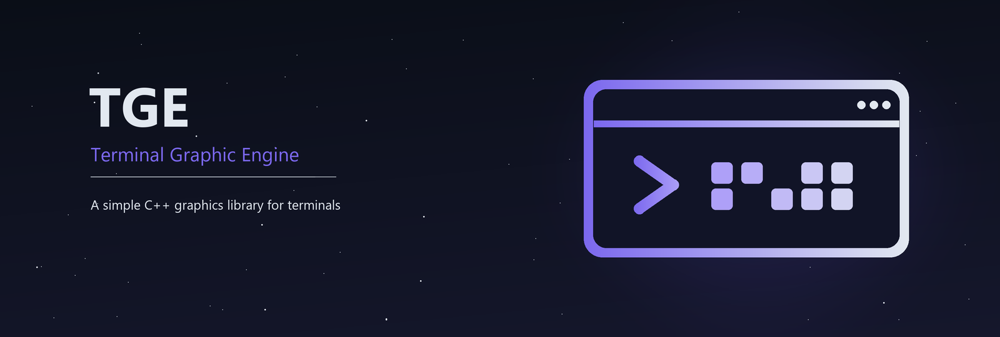

# TGE - Terminal Graphic Engine



[](#requirements-and-inclusion)
[](#requirements-and-inclusion)
[](TGE.hpp)
[](LICENSE)
[](https://github.com/Skell4/TGE/stargazers)

TGE is a **header-only C++17 library for drawing graphics in a terminal**.
Draw into a canvas in memory, then call `print()` to display it with 24-bit
ANSI colors. Each terminal cell holds two vertical pixels.

TGE began as a personal project for building graphical applications in the
terminal. It can be used for small interfaces, visual demos and terminal games,
including programs running without a desktop GUI.

The library provides:

- Pixels, lines, circles and rectangles, with filled and outline shapes.
- Image loading, scaling and drawing through the `.cimg` format.
- Texture mapping onto a quadrilateral.
- Bitmap text with letters, digits, symbols and some accented characters.
- Alpha-based RGB blending when drawing over existing pixels.
- Frame output that skips terminal cells unchanged since the previous print.

All public C++ types are in the lowercase **`tge` namespace**:
`tge::Color`, `tge::Canvas`, `tge::CImg` and `tge::Font`.
`tge::CImg` is an alias for `tge::Canvas`, so images and drawing surfaces use
the same type. Keyboard and mouse input are handled by your application.

## Contents

- [Files](#files)
- [Requirements and inclusion](#requirements-and-inclusion)
- [Quick start](#quick-start)
- [Pixels, frames and terminal sessions](#pixels-frames-and-terminal-sessions)
- [Images and textures](#images-and-textures)
- [Image converter and file format](#image-converter-and-file-format)
- [Public API](#public-api)
- [Updating older code](#updating-older-code)
- [License](#license)

## Files

| File | Purpose |
| --- | --- |
| [TGE.hpp](TGE.hpp) | The complete library. Copy this header into your project. |
| [img_to_cimg.html](img_to_cimg.html) | A local browser tool for converting images to `.cimg`. |
| [assets/](assets/) | The README banner in PNG and SVG formats. |
| [LICENSE](LICENSE) | The MIT license. |

## Requirements and inclusion

Use a compiler with **C++17 or later** and include `TGE.hpp` in your source
file. There is no separate library to build or link, and no third-party
dependencies. The header can be included in multiple source files.

For display, run the program in an interactive terminal with UTF-8 and
24-bit ANSI color support. The renderer uses the Unicode upper-half block
character `▀`. The terminal font and cell proportions affect the result.
An IDE's plain output panel may not provide the terminal features TGE needs.

The header uses native console APIs on Windows and Unix-style APIs on other
systems. On Windows, `initializeTerminal()` enables virtual terminal processing
and UTF-8 output; `resetTerminal()` attempts to restore the saved settings.
Compatibility still depends on the terminal host. The checks for this revision
used GCC/MinGW on Windows; other platforms and terminal hosts need their own
checks.

Save the first example below as `main.cpp`, next to `TGE.hpp`.

### Windows with GCC or MinGW

In PowerShell:

```powershell
g++ -std=c++17 -O2 -Wall -Wextra main.cpp -o demo.exe
.\demo.exe
```

### Windows with MSVC

In a Visual Studio developer command prompt:

```bat
cl /EHsc /std:c++17 /utf-8 main.cpp /Fe:demo.exe
demo.exe
```

### Linux with GCC

```sh
g++ -std=c++17 -O2 -Wall -Wextra main.cpp -o demo -pthread
./demo
```

## Quick start

This example creates a canvas that fits the current terminal, draws a few
shapes and a label, and waits for Enter before restoring the screen.

```cpp
#include "TGE.hpp"
#include <exception>
#include <iostream>

int main() {
    try {
        auto [width, height] = tge::Canvas::getScreenSize();
        tge::Canvas canvas(width, height, "TGE demo");

        canvas.setBG(tge::Color::black);
        canvas.drawFilledRect(2, 2, 30, 18, tge::Color::blue);
        canvas.drawCircle(17, 11, 7, tge::Color::yellow);
        canvas.drawText(L"TGE", 4, 24, tge::Color::white);

        tge::Canvas::initializeTerminal();
        canvas.print();
        std::cin.get();
    } catch (const std::exception& error) {
        tge::Canvas::resetTerminal();
        std::cerr << error.what() << '\n';
        return 1;
    }

    tge::Canvas::resetTerminal();
    return 0;
}
```

Drawing changes the canvas in memory. `print()` sends it to the terminal and
requires an active terminal session. You can create canvases, load images and
draw on them before calling `initializeTerminal()`.

## Pixels, frames and terminal sessions

### Coordinate system

Canvas dimensions and drawing coordinates are measured in **graphics pixels**.
The origin `(0, 0)` is at the top-left; X increases to the right and Y downward.
Drawing is clipped at the canvas edges.

One terminal cell displays two vertical pixels: the upper pixel is the
foreground of `▀`, and the lower pixel is its background. For example, a
terminal with 80 columns and 24 rows can display a canvas of 80 × 48 pixels.
`tge::Canvas::getScreenSize()` returns this pixel size, with the terminal row
count already doubled. It assumes output is attached to a working console or
terminal; it does not report query failures.

### Drawing a new frame

A canvas keeps its pixels between calls. Start each frame with `setBG()` when
you want to redraw the whole scene, then draw the scene and call `print()`.

For a short animation, replace `canvas.print()` in the first example with:

```cpp
for (int frame = 0; frame < 120; ++frame) {
    canvas.setBG(tge::Color::black);

    int x = frame % static_cast<int>(canvas.getWidth());
    canvas.drawFilledCircle(x, 12, 4, tge::Color::cyan);

    canvas.print();
    tge::Canvas::sleep(16);
}
```

`sleep(16)` adds a delay of 16 milliseconds per frame; it does not guarantee a
fixed frame rate. To follow terminal size changes, query `getScreenSize()`
again and pass the result to `canvas.resize(width, height)`.

**`clear()` releases the canvas buffers and resets its dimensions.** Use
`setBG()` to fill an existing canvas. After `clear()`, call `resize()` or
`load()` before drawing again.

### Opening and closing the terminal session

`initializeTerminal()` switches to the alternate screen, clears it and hides
the cursor. `resetTerminal()` leaves that screen and shows the cursor again.
These are static functions shared by all canvases.

Call `resetTerminal()` on normal exit and before reporting a handled error, as
in the example. Destroying a `Canvas` does not close the terminal session.

Use one canvas for display during a session. Each canvas remembers its own
previous frame, so alternating between display canvases or writing other text
to the terminal can make the cached frame differ from the visible screen.

## Images and textures

TGE loads its own `.cimg` format. Convert a source image with
`img_to_cimg.html`, place the result in the program's working directory, and
pass its filename to `tge::CImg` or `tge::Canvas`.

This is a complete example for a file named `photo.cimg`:

```cpp
#include "TGE.hpp"
#include <exception>
#include <iostream>

int main() {
    try {
        tge::CImg image("photo.cimg");
        auto [width, height] = tge::Canvas::getScreenSize();
        tge::Canvas screen(width, height);

        screen.setBG(tge::Color::black);
        screen.drawImg(image, 0, 0);

        tge::Canvas::initializeTerminal();
        screen.print();
        std::cin.get();
    } catch (const std::exception& error) {
        tge::Canvas::resetTerminal();
        std::cerr << error.what() << '\n';
        return 1;
    }

    tge::Canvas::resetTerminal();
    return 0;
}
```

`drawImg()` draws at the image's original pixel size and clips anything outside
the destination canvas. To resize an image first, use
`auto thumbnail = image.scaled(32, 24);` and draw the returned canvas. Scaling
samples source pixels without interpolation and does not change the original.

For texture mapping, replace `screen.drawImg(image, 0, 0)` above with:

```cpp
screen.drawTexture(image,
    2, 2,    // Source top-left maps here.
    33, 2,   // Source top-right.
    33, 25,  // Source bottom-right.
    2, 25);  // Source bottom-left.
```

The vertices describe the destination quadrilateral in perimeter order. TGE
splits it into two triangles and samples the source image without filtering.
The mapping is affine within each triangle, so a skewed quadrilateral can show
a change in distortion along the diagonal.

The filename constructor throws `std::runtime_error` when `load()` reports
failure. To check the result yourself, create a default canvas and call
`image.load("photo.cimg")`, which returns `false` for file-opening, dimension
or incomplete-data errors. Allocation failures can still throw. A failed load
leaves the previous image unchanged.

## Image converter and file format

### Convert an image

1. Open [img_to_cimg.html](img_to_cimg.html) in a browser.
2. Drop an image onto the page, or click the drop area to select one.
3. Check the preview, pixel dimensions and estimated output size.
4. Click **Convert and Download .cimg**.

The conversion runs locally in the browser and does not upload your image.
Accepted formats depend on the browser's image decoder. The converter keeps
the original dimensions and writes RGBA pixels; it has no resizing options.
Use `scaled()` in C++ or resize the source image before converting it.

The C++ loader reads `.cimg` files directly. PNG, JPEG and other source formats
must go through the converter first.

### Binary layout

`.cimg` files are uncompressed and contain no magic number or version field.

| Offset | Length | Contents |
| --- | ---: | --- |
| 0 | 4 bytes | Width: unsigned 32-bit integer, little-endian. |
| 4 | 4 bytes | Height: unsigned 32-bit integer, little-endian. |
| 8 | 4 bytes per pixel | Red, green, blue, alpha: one byte per channel. |

Pixels start at the top-left and run left to right, then top to bottom. Both
dimensions must be positive. A file produced by the converter has a total size
of `8 + width × height × 4` bytes.

The converter explicitly writes little-endian dimensions. The current C++
loader reads them in the machine's native byte order, so these files are
directly compatible with little-endian targets. The loader checks for missing
pixel data but does not reject extra bytes after the expected pixels.

## Public API

The tables below use `canvas` for an instance of `tge::Canvas`. Constructor and
member names are shortened inside their class section; use the `tge::` prefix
when naming a type in your code.

### `tge::Color`

Stores red, green, blue and alpha channels in the range `0–255`. There are no
individual channel getters. Constructors and setters take unsigned channel
values and reject values above 255 with `std::invalid_argument`.

| Constructor or member | Purpose |
| --- | --- |
| `Color()` | Opaque black: `(0, 0, 0, 255)`. |
| `Color(r, g, b, a = 255)` | Creates an RGBA color. |
| `setRGB(r, g, b)` | Sets RGB and resets alpha to 255. |
| `setRGBA(r, g, b, a)` | Sets all four channels. |
| `overlapColor(above)` | Returns the RGB blend of `above` over this color. |
| `toString()` | Returns `r,g,b,a` as text. |
| `toChars(buffer)` | Writes `r;g;b` without a null terminator and returns its length. Supply at least 12 writable bytes. |
| `operator==`, `operator=` | Compares or copies all four channels. |

Drawing uses the incoming color's alpha to blend RGB channels. An incoming
alpha of zero leaves the destination unchanged; a nonzero alpha produces an
opaque blend result. Blending uses integer arithmetic. Set a canvas background
with `setBG()` when you want to replace its pixels directly.

Built-in colors are available as `tge::Color::name`; all have alpha 255:

| Name | RGB | Name | RGB |
| --- | --- | --- | --- |
| `white` | `255,255,255` | `black` | `0,0,0` |
| `red` | `255,0,0` | `green` | `0,255,0` |
| `blue` | `0,0,255` | `yellow` | `255,255,0` |
| `cyan` | `0,255,255` | `magenta` | `255,0,255` |
| `light_grey` | `200,200,200` | `grey` | `128,128,128` |
| `dark_grey` | `50,50,50` | `orange` | `255,165,0` |
| `purple` | `128,0,128` | `pink` | `255,192,203` |
| `brown` | `139,69,19` | `lime` | `50,205,50` |
| `navy` | `0,0,128` | `teal` | `0,128,128` |
| `olive` | `128,128,0` | `gold` | `255,215,0` |
| `silver` | `192,192,192` | `bronze` | `205,127,50` |
| `sky_blue` | `135,206,235` | `violet` | `238,130,238` |
| `indigo` | `75,0,130` | `turquoise` | `64,224,208` |

### `tge::Canvas` / `tge::CImg`

#### Construction

| Constructor | Purpose |
| --- | --- |
| `Canvas()` | Creates an uninitialized canvas. Call `resize()` or `load()` before drawing. |
| `Canvas(width, height)` | Creates a surface filled with `CONSOLE_BG_COLOR`. |
| `Canvas(width, height, title)` | Also stores a window title, applied during `print()`. |
| `Canvas(width, height, pixels)` | Copies a row-major `std::vector<tge::Color>` of exactly `width × height` elements. |
| `Canvas(file_name)` | Loads a `.cimg` image or throws `std::runtime_error` when loading reports failure. |

Dimensions use `size_t` and must be positive. Zero dimensions or an incorrectly
sized pixel vector cause `std::invalid_argument`. Operations that need pixel
data throw `std::logic_error` on an uninitialized canvas.

#### Terminal functions

| Call | Purpose |
| --- | --- |
| `tge::Canvas::initializeTerminal()` | Opens the terminal session. Repeated calls while active do nothing. |
| `tge::Canvas::resetTerminal()` | Closes the session; safe to call when it is already closed. |
| `tge::Canvas::isTerminalInitialized()` | Reports whether TGE considers the session active. |
| `tge::Canvas::getScreenSize()` | Returns `std::pair<int, int>` containing width and height in graphics pixels. |
| `tge::Canvas::setTitle(title)` | Sets the terminal window title immediately. |
| `tge::Canvas::sleep(ms)` | Sleeps for the requested number of milliseconds. |
| `canvas.print()` | Displays the frame, skipping unchanged cells. Requires an initialized canvas and active terminal session. |

#### State and image operations

| Member | Purpose |
| --- | --- |
| `getWidth()`, `getHeight()` | Returns the dimensions in pixels. |
| `isInitialized()` | Reports whether the canvas has valid dimensions and pixel storage. |
| `load(file_name)` | Loads a `.cimg` file. Returns `bool`. |
| `scaled(width, height)` | Returns a resized image using source-pixel sampling. Positive dimensions are required. |
| `screenshot()` | Returns a copy of the canvas pixels as a new canvas. |
| `resize(width, height)` | Replaces the pixels with `CONSOLE_BG_COLOR`. Returns `false` without changing pixels if the initialized canvas already has that size. |
| `setImageMode(bool)`, `isImage()` | Sets or reads the image-mode flag. Image mode releases auxiliary drawing/output buffers; `print()` switches it off. |
| `clear()` | Releases buffers, resets dimensions and removes the stored title. |
| `operator=`, copy constructor | Copies canvas state and buffers. |
| `operator==` | Compares dimensions and pixels; ignores the title, image-mode flag and output cache. |

When a terminal session is active, a size-changing `resize()` also emits
terminal sequences to clear scrollback and move the cursor home.

#### Drawing operations

All coordinates below are in graphics pixels. Color arguments are
`tge::Color` values, and image arguments are `tge::Canvas` / `tge::CImg` values.

| Member | Purpose |
| --- | --- |
| `setBG(color)` | Replaces every pixel with the given color. |
| `drawPixel(x, y, color)` | Blends one pixel. |
| `drawLine(x0, y0, x1, y1, thickness, color)` | Draws a line with the requested thickness. |
| `drawCircle(cx, cy, radius, color)` | Draws a one-pixel circle outline. |
| `drawFilledCircle(cx, cy, radius, color)` | Draws a filled circle. |
| `drawRect(x, y, width, height, thickness, color)` | Draws a rectangle outline. |
| `drawFilledRect(x, y, width, height, color)` | Draws a filled rectangle. |
| `drawImg(image, x, y)` | Draws an image at its original size. Returns `bool`. |
| `drawText(text, x, y, color)` | Draws a `std::wstring` using the built-in bitmap font. |
| `drawTexture(image, x0, y0, x1, y1, x2, y2, x3, y3)` | Maps an image onto four vertices. Returns `bool`. |

Nonpositive line or rectangle-outline thickness draws nothing. Negative circle
radii and nonpositive filled-rectangle dimensions also draw nothing.
`drawRect()` accepts negative width or height by shifting the rectangle's
origin and using the corresponding positive size.

`drawImg()` and `drawTexture()` return `true` on normal completion, including
when drawing is fully clipped. Their return value does not tell you whether
any pixels became visible. They throw if the source or destination canvas is
uninitialized.

### Text rendering and `tge::Font`

Pass a wide string literal, such as `L"Hello, TGE!"`, to `drawText()`. Text
starts at the supplied pixel position and advances by each glyph's bitmap
width. It stays on one line: line breaks and other unsupported characters are
rendered as `?`.

Supported characters:

- Lowercase letters: `a–z`, plus `à è é ì ò ù`.
- Uppercase letters: `A–Z`.
- Digits: `0–9`.
- Space and the symbols below.

```text
! ? . , : ; ' " + - * / \ | ( ) [ ] { } = & % £ $ € _ # @ < > ^
```

For a single character image, use
`tge::Font::basic_char(wchar_t ch, tge::Color color)`. For example:

```cpp
tge::CImg letter = tge::Font::basic_char(L'A', tge::Color::white);
canvas.drawImg(letter, 2, 2);
```

### Default background

`CONSOLE_BG_COLOR` controls the fill used by `Canvas(width, height)`, its
title-taking variant and `resize()`. It also fills the lower half of the last
row of terminal cells for odd canvas heights. Its default is
`::tge::Color(12, 12, 12)`.

To change it, define the macro **before** including the header:

```cpp
#define CONSOLE_BG_COLOR ::tge::Color(20, 24, 32)
#include "TGE.hpp"
```

Use the same definition in every source file that includes TGE. The macro is
a preprocessor setting and has no namespace prefix. To change only one canvas
at runtime, call `canvas.setBG(color)` instead.

## Updating older code

The current header places the library's public types in the lowercase `tge`
namespace. Update older examples and applications to use these names:

| Earlier name | Current name |
| --- | --- |
| `Color` | `tge::Color` |
| `Canvas` | `tge::Canvas` |
| `CImg` | `tge::CImg` |
| `Font` | `tge::Font` |

For example, use `tge::Canvas::initializeTerminal()` and `tge::Color::white`.
Member calls on an existing object, such as `canvas.print()`, keep the same
syntax. No aliases are added to the global namespace.

In older versions, `CImg` was a separate class. It is now an alias for
`tge::Canvas`; loading, scaling and drawing images use the canvas API.

## License

TGE is available under the [MIT license](LICENSE). See `LICENSE` for the full terms.
